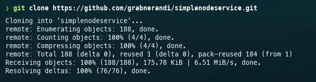
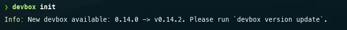
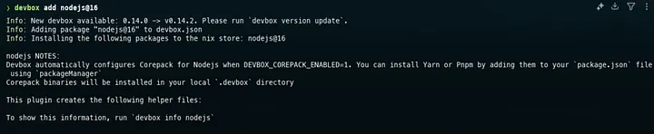
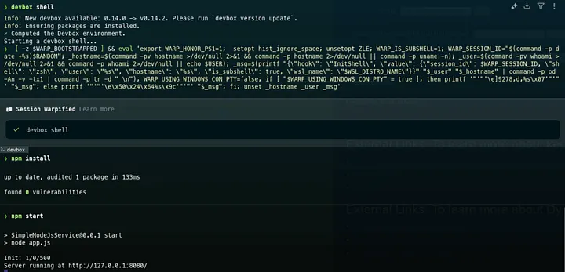

Você já passou pelo perrengue de precisar instalar o NodeJS na versão 16 só pra testar alguma coisinha no seu notebook ou PC? Ou de ter que baixar o Python 3.10 só pra rodar um script que depende de uma lib específica?

Pois é… nem sempre dá (ou vale) subir uma VM, pagar uma VPS, ou montar um ambiente full só pra uma validação rápida. Muitas vezes, a gente só quer testar um serviço de um repositório, validar um script, ou ver se uma ferramenta atende — sem precisar fazer todo aquele ritual de instalação. E nem sempre "dockerizar" compensa.

Recentemente, precisei rodar alguns testes e demonstrações, e me vi nessa mesma situação: testar rapidamente alguns repos em ambientes temporários. Foi aí que decidi usar o Devbox, da Jetify — e, olha, mudou meu fluxo de testes.

## Por que o Devbox?

Na essência, o Devbox é parecido com rodar um container, mas com uma abordagem mais direta: ele isola o ambiente direto no shell, sem exigir um `Dockerfile`, criação de imagem ou aquele overhead tradicional do Docker. Em vez disso, você simplesmente cria o ambiente com um comando, escolhe a versão da ferramenta que quer usar e trabalha ali mesmo — sem impactar seu SO ou bagunçar suas libs globais.

## Um exemplo prático e real

Deixa eu te contar um caso concreto.

Costumo usar um repositório muito legal do Andreas Grabner (o Andy), que traz uma aplicação em NodeJS com uma interface simples e um load generator. Queria testar o app antes de empacotar e subir num ambiente para testes. Mas… não sou desenvolvedor, e muito menos especialista em NodeJS. Não fazia sentido instalar o Node e o npm no meu sistema só pra ver se aquilo ia me servir. Ainda mais que o app precisava especificamente do Node 16, que já está um pouco defasado.

Com o Devbox, fiz o teste assim, direto do shell:

**Pré-requisito:** ter o Devbox instalado no sistema.

**Passo a passo:**

1. Clonar o repositório:

```bash
git clone https://github.com/grabnerandi/simplenodeservice.git
```




2. Entrar na pasta do repositório e inicializar o Devbox:

```bash
cd simplenodeservice
devbox init
```




3. Adicionar a versão específica do NodeJS:

```bash
devbox add nodejs@16
```




4. Entrar no ambiente isolado com o Devbox:

```bash
devbox shell
```

5. Instalar dependências e subir a aplicação:

```bash
npm install
npm start
```




E pronto. Aplicação no ar. Sem sujeira, sem dor de cabeça. Zero impacto no sistema operacional.

## Por que isso foi tão útil?

Simples: consegui testar repositórios, validar ambientes de IaC com Terraform, rodar scripts em Python, executar playbooks do Ansible e tudo mais — sempre com ambientes isolados, reaproveitáveis e consistentes. Inclusive, comecei a manter o `devbox.json` nos meus repos, pra não precisar instalar nada manualmente quando subo uma EC2 temporária, por exemplo.

Ah, e o Devbox ainda oferece outras funcionalidades bem interessantes:

- Inicialização com configuração explícita;
- Execução de ambientes como serviço;
- Facilidade para reprodutibilidade de ambientes de desenvolvimento.

## Como instalar?

Se estiver usando um sistema Unix-like (Linux/macOS), a instalação é direta:

```bash
curl -fsSL https://get.jetify.com/devbox | bash
```

O instalador também vai pedir o Nix, que é usado como gerenciador de pacotes e dependências por baixo dos panos.

## Conclusão

Se você é dev, infra, SRE, ou só alguém que vive testando coisas novas, o Devbox é uma baita mão na roda. Simples, leve e direto ao ponto.

Fica aqui minha dica. Espero que te ajude tanto quanto me ajudou. E se quiser trocar ideia, tirar dúvidas ou compartilhar seu uso, chama a gente — bora aprender juntos!